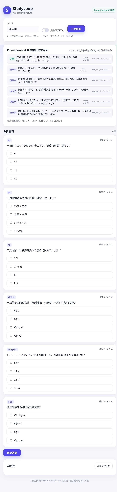
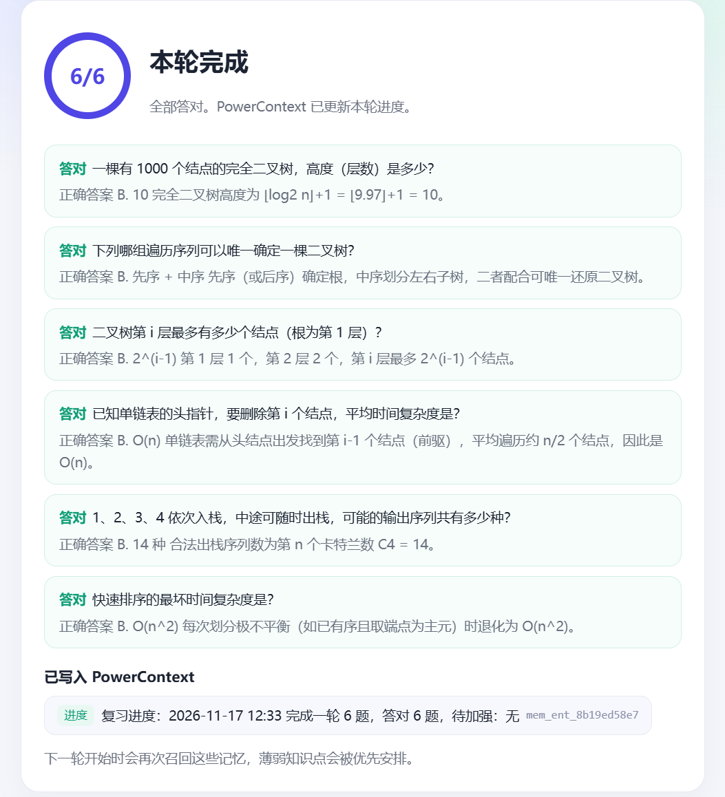

# StudyLoop · 会记住你的复习教练

StudyLoop 是一个面向数据结构复习的本地 Web 应用：它会记住每个学习者的薄弱知识点、复习进度和偏好，并在下一次复习时自动召回，把历史错题主题排在前面。

- 项目形式：Web 应用（FastAPI + 原生前端）
- 指定技术：**PowerContext**（记忆与上下文），本地部署，无需模型 API Key
- 开发工具：Qoder CN（见 [docs/DEVLOG.md](docs/DEVLOG.md)）
- 记忆存储：PowerContext Server 1.2.0（SQLite 后端）
- 项目网站：<https://studyloop-7cdph2t6uli.qoder.zone>（Qoder Sites，公开访问）
- 代码仓库：<https://github.com/FRabandoning/PowerContext_problem/tree/qoder-studyloop/qoder>

## 1. 解决的问题

期末复习时常见的循环是：错过的题下次还会错，换一台设备或隔一周再打开，之前的复习进度和薄弱点完全找不到。StudyLoop 把「薄弱点」从聊天记录和错题本里搬到 PowerContext：

1. 每轮答题结束后，答错的题目按主题写入 PowerContext（`kind=weakness`），同时记录本轮进度（`kind=progress`）。
2. 下一次打开（新进程、新会话），应用按学习者读取记忆，把历史薄弱主题加权，优先出相关题目。
3. 选择「只复习薄弱点」时，偏好也会写入记忆（`kind=preference`），下次自动恢复。

技术分工：题目、评分和界面由应用自身完成；**跨会话的学习档案完全由 PowerContext 承载**，应用不保存任何本地学习状态。

## 2. 功能

- 按学习者隔离的复习档案（每个学习者一个 PowerContext Scope）
- 记忆召回面板：展示本轮实际用到的记忆、命中方式和 Entry ID
- 自适应排题：薄弱主题加权，默认 6 题
- 答题结果与解析
- 答错自动沉淀为薄弱点（同一道题不重复写入）
- 每轮结束写入进度；「只复习薄弱点」写入偏好
- 记忆库视图：查看当前学习者的全部记忆

## 3. 运行说明

### 3.1 环境

- Python 3.11+、Git、[uv](https://docs.astral.sh/uv/)
- 端口：PowerContext `127.0.0.1:8000`，StudyLoop `127.0.0.1:7860`

### 3.2 安装并启动 PowerContext

```bash
uv tool install --force "powercontext[cli,server]==1.2.0"
powercontext server run
```

保持该终端运行。看到 `Uvicorn running on http://127.0.0.1:8000` 即可。

### 3.3 启动 StudyLoop

另开一个终端，在 `qoder/` 目录下：

```bash
uv venv .venv
# Windows
uv pip install -r requirements.txt --python .venv/Scripts/python.exe
.venv/Scripts/python.exe app.py
# macOS / Linux
uv pip install -r requirements.txt --python .venv/bin/python
.venv/bin/python app.py
```

浏览器打开 <http://127.0.0.1:7860>。

可选环境变量：

| 变量 | 默认值 | 说明 |
| --- | --- | --- |
| `POWERCONTEXT_URL` | `http://127.0.0.1:8000` | PowerContext Server 地址 |
| `APP_HOST` / `APP_PORT` | `127.0.0.1` / `7860` | StudyLoop 监听地址 |

### 3.4 体验流程

1. 输入学习者名称，点击「开始复习」。
2. 第一轮没有记忆，按难度出题；答完提交，结果页会列出写入 PowerContext 的条目（含 Entry ID）。
3. 点击「再来一轮」：召回面板会显示上一轮的薄弱点与进度，错过的主题被排到前面。
4. 勾选「只复习薄弱点」后再开始，排题范围会收紧，并且偏好会写入记忆。

## 4. 验证样例

保持两个服务运行，执行：

```bash
.venv/Scripts/python.exe scripts/verify_demo.py   # macOS/Linux: .venv/bin/python
```

脚本会模拟两轮复习：第一轮全部选 A 制造错题，第二轮作为「新会话」检查记忆是否被召回、薄弱主题是否被优先安排。全部通过时输出：

```text
验证通过：PowerContext 中的记忆确实被后续会话复用。
```

脚本使用独立学习者「验证样例用户」，不会影响你自己的复习档案。

## 5. 目录结构

```text
qoder/
├─ app.py                  # FastAPI 接口与页面服务
├─ powercontext_client.py  # PowerContext HTTP 客户端
├─ planner.py              # 从记忆中提取薄弱点并排题
├─ data/questions.json     # 14 道数据结构题目
├─ static/                 # 前端页面
├─ scripts/verify_demo.py  # 端到端验证脚本
└─ docs/
   ├─ DEVLOG.md            # Qoder 开发记录
   └─ screenshots/         # 运行截图
```

## 6. PowerContext 使用说明

| 能力 | 实现位置 | 调用 |
| --- | --- | --- |
| 学习者隔离 | `ensure_scope()` | `GET /v1/scopes`、`POST /v1/scopes` |
| 写入薄弱点/进度/偏好 | `/api/session/submit`、`/api/session/start` | `POST /v1/memory/remember` |
| 召回记忆 | `recall()` | `POST /v1/memory/search` |
| 记忆库 | `/api/memory` | `POST /v1/memory/entries/list` |
| 连接状态 | `/api/health` | `GET /health/ready` |

未配置模型的本地 Server 使用全文检索（响应中的 `mode: "fts"`）完成召回；配置生成模型与向量检索后接口不变。

## 7. 已知限制

- PowerContext 在 Windows 上属于官方标记的 experimental 能力，本项目在 Windows 11 + Python 3.12 下验证通过。
- 题库为固定 14 题，排题只做主题加权，不调用大模型生成新题。
- 应用不保存本地学习状态；PowerContext 停止后，记忆不可用（这正是验证记忆真实来源的方式）。

## 8. 截图

| 召回与排题 | 结果与记忆写入 | 记忆库 |
| --- | --- | --- |
|  |  |  |